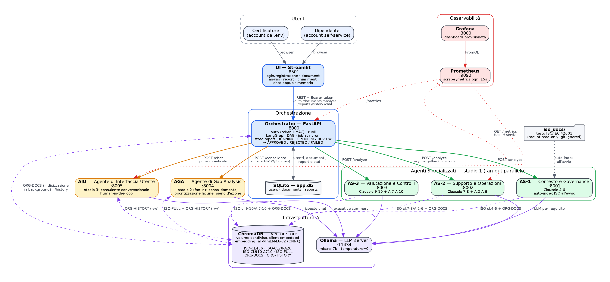

# Compliance AI by Design

Multi-agent system for the gap analysis of an organization's documentation
against **ISO/IEC 42001:2023** (AI management systems).

Code accompanying the master's thesis *"Compliance AI by Design: sviluppo di
un sistema intelligente per la gap analysis e la verifica dei requisiti
ISO/IEC 42001:2023"*, Università Campus Bio-Medico di Roma, Laurea Magistrale
in Ingegneria dei Sistemi Intelligenti.
Supervisor: Prof. Paolo Soda. Co-supervisor: Prof. Floriano Caprio.

## How it works

Three Specialized Agents evaluate the company documents, each over its own
portion of the standard:

| Agent | Scope |
|-------|-------|
| AS-1  | Clauses 4, 5, 6 |
| AS-2  | Clauses 7, 8 and Annex A.2–A.6 |
| AS-3  | Clauses 9, 10 and Annex A.7–A.10 |

Each agent produces one evaluation card per requirement (70 in total), with a
verdict (`CONFORME`, `PARZIALMENTE_CONFORME`, `NON_CONFORME`,
`NON_APPLICABILE`), the cited evidence and a corrective action. Every cited
excerpt is checked against the text actually retrieved before a positive
verdict is accepted (`shared/grounding.py`).

The Gap Analysis Agent (**AGA**) consolidates the cards into a report with a
score and prioritized gaps. The User Interface Agent (**AIU**) answers
questions about the report in a chat. A LangGraph orchestrator coordinates
the pipeline, and a certifier must approve each report before employees
can see it.

Requirements are not hard-coded: they are derived from the indexed text of
the standard. Retrieval uses ChromaDB, and inference runs locally with
Ollama (Mistral 7B by default).



## Repository layout

| Path | Contents |
|------|----------|
| `services/as1`, `as2`, `as3`, `aga`, `aiu` | The five agents (FastAPI microservices) |
| `orchestrator/` | Public API, LangGraph graph, SQLite persistence, external source sync |
| `rag/` | ChromaDB collections, document indexing, requirement loading |
| `shared/` | Data models, configuration, auth, grounding check, Prometheus metrics |
| `connectors/` | GitHub and Confluence connectors |
| `ui/` | Streamlit web interface |
| `scripts/` | ISO indexing, KPI evaluation, validation tools |
| `tests/` | Unit tests and KPI/integration tests |
| `kubernetes/`, `monitoring/` | Deployment manifests, Prometheus and Grafana |

## Running it

Requirements: Docker with Compose. Without a GPU, inference is slow: a full
analysis can take a long time.

1. **Configure.** Copy `.env.example` to `.env` and change at least
   `SECRET_KEY` and `CERTIFIER_PASSWORD`.
2. **Add the standard.** ISO/IEC 42001 is licensed and is not in the
   repository. Put your copy in `iso_docs/`, for example as `iso42001.txt`
   (see `iso_docs/README.md`). It is indexed automatically on first start.
3. **Start the stack and pull the model:**

   ```bash
   docker compose up -d --build
   docker exec ollama ollama pull mistral:7b
   ```

4. **Open the UI** at <http://localhost:8501>. Log in as the certifier
   (`CERTIFIER_USERNAME` / `CERTIFIER_PASSWORD`), or register an employee
   account, upload documents and start an analysis.

| Service | URL |
|---------|-----|
| Web UI | http://localhost:8501 |
| Orchestrator API (OpenAPI docs at `/docs`) | http://localhost:8000 |
| Grafana | http://localhost:3000 |
| Prometheus | http://localhost:9090 |

To use Anthropic instead of Ollama, set `LLM_PROVIDER=anthropic`,
`ANTHROPIC_API_KEY` and `ANTHROPIC_MODEL` in `.env`.

## Tests and validation

Unit tests (no running services needed):

```bash
pytest tests/test_grounding.py tests/test_indexing.py \
       tests/test_iso_index_status.py tests/test_chunk_sensitivity.py \
       tests/test_traceability.py
```

KPI and integration tests (`tests/test_core.py`, `tests/test_extended.py`)
require the full stack running on localhost.

Validation scripts:

- `scripts/run_evaluation.py`: runs the pipeline K times on a corpus and
  prints TCN, schema validity and IR (thesis §3.2.3, §3.6.2).
- `scripts/extended_reproducibility.py`: extended reproducibility test with
  K = 10 runs (thesis §3.6.2, results in §5.2.2).
- `scripts/compare_ground_truth.py`: compares a report's verdicts with a
  ground-truth CSV.
- `scripts/chunk_sensitivity.py`: chunk-size sensitivity analysis, listed
  among the future developments (see `docs/validation/chunk_sensitivity.md`).

The test corpora and ground truths used in the thesis are not included in
the repository.
